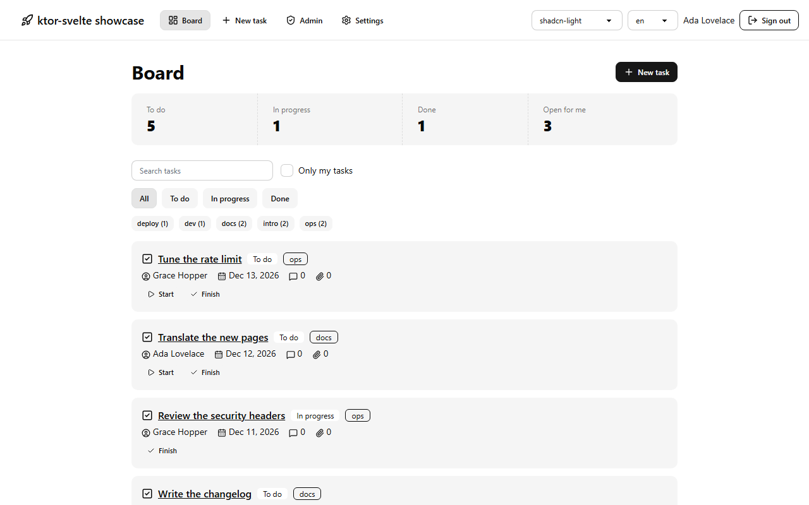

# Examples

Three example apps live in the repository, from the smallest possible app to a full team board with sign in. They are separate Gradle builds that use ktor-svelte the way your project does, and they double as the end-to-end tests, so they always work with the current code.

| Example | Size | Best for |
|---|---|---|
| [basic](#basic) | One route, three pages | Seeing the minimum that works |
| [notes](#notes) | A notes app | Each feature on its own, easy to find |
| [showcase](#showcase) | A team board with users | Features working together in a real app |

## Run them

Clone the repository, then start an example with everything in one command:

```bash
git clone https://github.com/nijasc/ktor-svelte.git
cd ktor-svelte
./gradlew -p examples/notes svelteDevAll
```

Open `http://localhost:8080`. In IntelliJ, open the repository and run the `Notes: Dev`, `Showcase: Dev` or `Basic: Dev` run configuration instead. You need Java 17 or newer and [Bun](https://bun.sh).

To build and run the production JAR:

```bash
./gradlew -p examples/notes buildFatJar
```

```bash
java -jar examples/notes/build/libs/notes-all.jar
```

The showcase builds the same way with `buildFatJar`. The basic example uses Shadow instead, so its task is `shadowJar`.

## basic

[`examples/basic`](https://github.com/nijasc/ktor-svelte/tree/main/examples/basic) is the smallest possible app: `install(Svelte)` with no settings, one API route and three pages.

| Look at | To see |
|---|---|
| `src/main/kotlin/Application.kt` | `install(Svelte)` with no settings, and one API route |
| `frontend/src/routes/+page.svelte`, `about/` | Prerendered pages |
| `frontend/src/routes/app/` | A page that renders in the browser and calls the API |
| `frontend/vite.config.ts` | The `adapter-static` setup SvelteKit needs |

Start here when you want to see what ktor-svelte does before any of its options.

## notes

[`examples/notes`](https://github.com/nijasc/ktor-svelte/tree/main/examples/notes) is a small notes app that uses almost every feature, each in a place that is easy to find. The [tutorial](guide/tutorial.md) builds a smaller version of it step by step.

| Look at | To see |
|---|---|
| `src/main/kotlin/notes/Application.kt` | `generateTs`, `transport { json(); xml(); compression() }`, `publicConfig` and `apiDocs` |
| `src/main/kotlin/notes/Model.kt` | DTOs with `@JsonSchema` bounds and `Validated` rules, a query class, a sealed `Activity` and `Page<Note>` |
| `src/main/kotlin/notes/Routes.kt` | CRUD routes with `resource`, typed 404 errors, a paged feed with `getPage` and multipart attachments |
| `build.gradle.kts` | Tailwind, DaisyUI with a custom theme, Lucide, typed routes, images, toasts and i18n, all in `svelte { libraries { } }` |
| `frontend/src/lib/api/` | The generated client, committed |
| `frontend/src/routes/notes/+page.svelte` | Forms with `use:field`, client and server validation, search and tag filters |
| `frontend/src/routes/notes/[id]/` | A dynamic route with `apiWith(event)` in `load` and typed errors |
| `frontend/src/routes/+layout.svelte` | DaisyUI themes, Lucide icons and i18n with a language switcher |
| `src/e2eTest/kotlin/NotesAppTest.kt` | How the production JAR is tested end to end |

### Things to try

While `svelteDevAll` runs:

- Change a Svelte file: the page updates without a reload.
- Add a property to `Note` in `Model.kt`: the app restarts, and `frontend/src/lib/api/types.ts` gains the property a moment later.
- Open `http://localhost:8080/api/docs` for Swagger UI.
- Submit an empty title: the error comes from the generated `validate()` before any request is sent.
- Click the **API** button in the corner of a page to see every call, with its status and time.

## showcase

[`examples/showcase`](https://github.com/nijasc/ktor-svelte/tree/main/examples/showcase) is a team board that people sign in to. Where notes shows each feature on its own, the showcase shows them working together the way a real app needs them: pages behind a login, an admin area, a database and uploads.



```bash
./gradlew -p examples/showcase svelteDevAll
```

### Signing in

The first start creates two people, `ada@example.com` as admin and `grace@example.com` as member. Set their passwords with `SHOWCASE_ADMIN_PASSWORD` and `SHOWCASE_MEMBER_PASSWORD`, at least 10 characters each. Without them, the app generates passwords and writes them to its log once.

The data lives in `examples/showcase/build/showcase-data`, so `./gradlew -p examples/showcase clean` starts over.

### Where to look

| Look at | To see |
|---|---|
| `src/main/kotlin/showcase/Application.kt` | `routing = SvelteRouting.Manual` with public pages, everything else behind `authenticate`, a named rate limit and a health check that asks the database |
| `src/main/kotlin/showcase/Application.kt` | Environment variables declared once with `environment`, and `startupStep` for the slow parts of startup |
| `src/main/kotlin/showcase/Application.kt` | `currentUser<User>`, `loginPage`, `permissions`, `preferences` and page `guards`, declared once for both sides |
| `src/main/kotlin/showcase/Application.kt` | `constants`, `errorCodes`, `idempotency()`, `frontendErrors()`, `webVitals` and a typed cookie |
| `src/main/kotlin/showcase/Auth.kt` | A signed session cookie, sign in, registration, and an admin area guarded on the server |
| `src/main/kotlin/showcase/Database.kt`, `src/main/resources/db/migration/` | Exposed on an embedded H2 database, with Flyway migrations |
| `src/main/kotlin/showcase/TaskRoutes.kt` | Paged and filtered lists, typed errors in the language of the person, multipart uploads with a size and type check, and downloads that browsers never run as a page |
| `src/main/kotlin/showcase/Model.kt` | `@JsonSchema` bounds, `Validated` rules and a sealed `Activity` that becomes a TypeScript union |
| `build.gradle.kts` | Every frontend library at once: themes with a custom one, fonts, charts, an installable app, components, toasts with a reload prompt and i18n |
| `frontend/src/routes/+layout.svelte` | The generated `currentUser` store that the header reads |
| `frontend/src/routes/(app)/+layout.ts` | A layout group for the pages that need a session |
| `frontend/src/routes/(app)/board/+page.svelte` | Search as you type with `latest`, filters, "load more" with a cursor, and `prefetchOnHover` |
| `frontend/src/routes/(app)/tasks/[id]/+page.svelte` | Uploads with a progress bar, comments, `Activity.match` and a confirm dialog |
| `frontend/src/lib/components/TaskForm.svelte` | One form for creating and editing, with `use:field` and errors from the browser and the server |
| `frontend/messages/` | English and German texts that the pages and the API errors share |
| `frontend/src/emails/Welcome.svelte` | A welcome email in English and German with a shared layout, rendered on registration and shown to admins at `/api/admin/emails/welcome` |
| `src/e2eTest/kotlin/ShowcaseAppTest.kt` | Sessions, roles, uploads, paging and rate limits tested against the production JAR |
| `src/browserTest/kotlin/ShowcaseBrowserTest.kt` | The same JAR driven by Playwright in Chromium, Firefox and WebKit, with accessibility checks |
| `src/devBrowserTest/kotlin/DevModeBrowserTest.kt` | `svelteDevAll` with a browser: hot reload, a restart after a Kotlin change, and browser errors in the dev log |

### Environment variables

| Variable | What it does |
|---|---|
| `PORT` | The port the server listens on, 8080 unless you set it |
| `SESSION_SIGN_KEY` | 64 hex characters that sign the session cookie, so sessions survive a restart |
| `SHOWCASE_DATA` | Where the database and the uploaded files go |
| `SHOWCASE_REGISTRATION` | `closed` stops new people from creating an account |
| `SHOWCASE_LOGIN_ATTEMPTS` | Sign-in attempts allowed per minute, 10 unless you set it |
| `SHOWCASE_SESSION_SECONDS` | How long someone stays signed in, a week unless you set it |
| `SHOWCASE_SITE_URL` | The public address of the site, for the sitemap |
| `SHOWCASE_INSECURE_COOKIES` | `true` to test the JAR over plain HTTP in browsers that do not treat `localhost` as secure |
| `APP_NAME` | The name shown in the header |

The pictures on the [start page](./index.md) come from `./gradlew -p examples/showcase screenshots`, which starts the showcase JAR in a headless Chromium.

## Your own examples

The [recipes](recipes/index.md) show complete solutions for sessions, uploads, live updates, paging and an admin area that you can copy into your app. [Everything ktor-svelte does](features/index.md) links every feature to its page.
