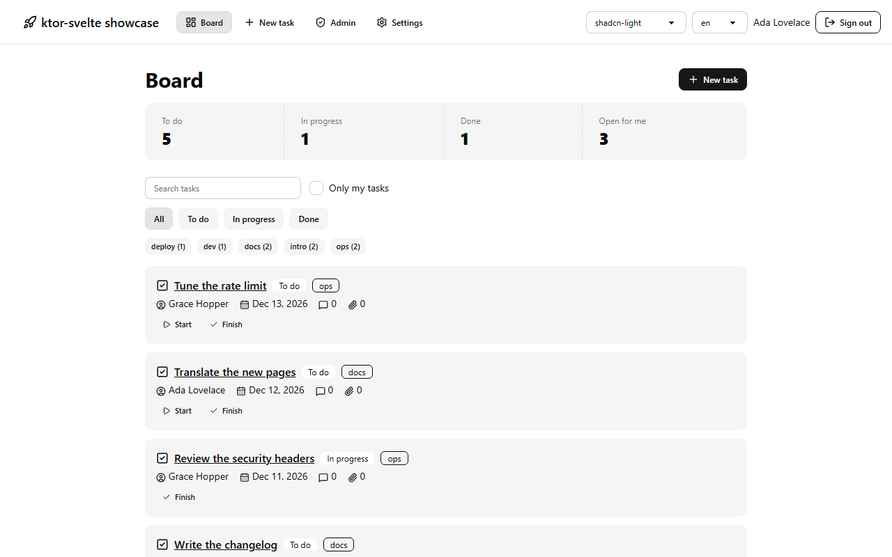
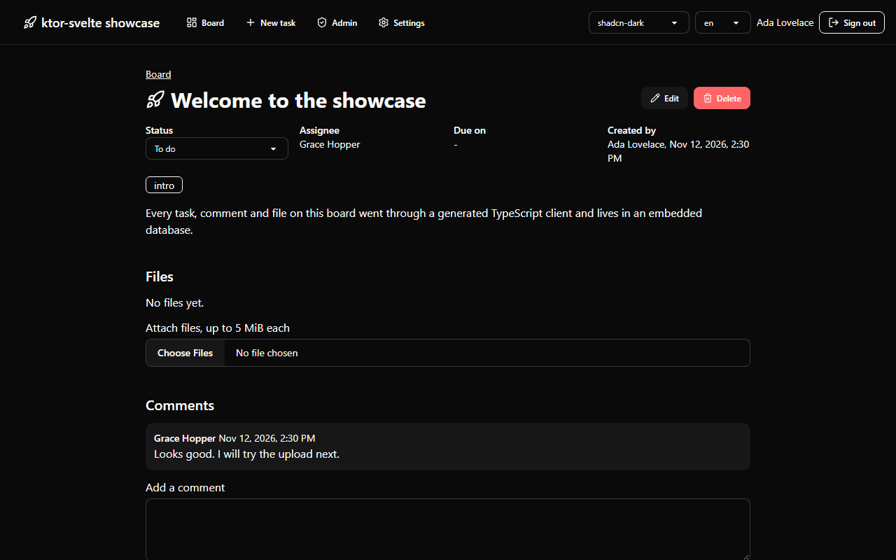
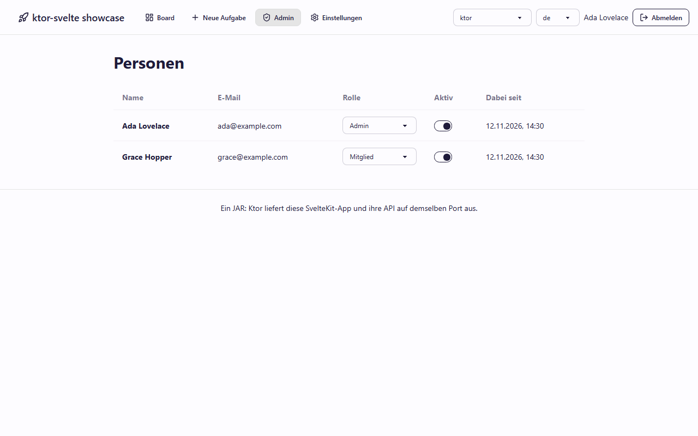

## See it in an app

The [showcase example](./examples.md#showcase) is a team board with sign in, roles, a database, file uploads, search and two languages. These are pictures of its production JAR: one process that serves the pages and the API.

A task in the dark theme, with its files and comments:

The admin area in German and in a custom theme, both set from Gradle:

The pictures come from `./gradlew -p examples/showcase screenshots`, so they show what the current code does.
