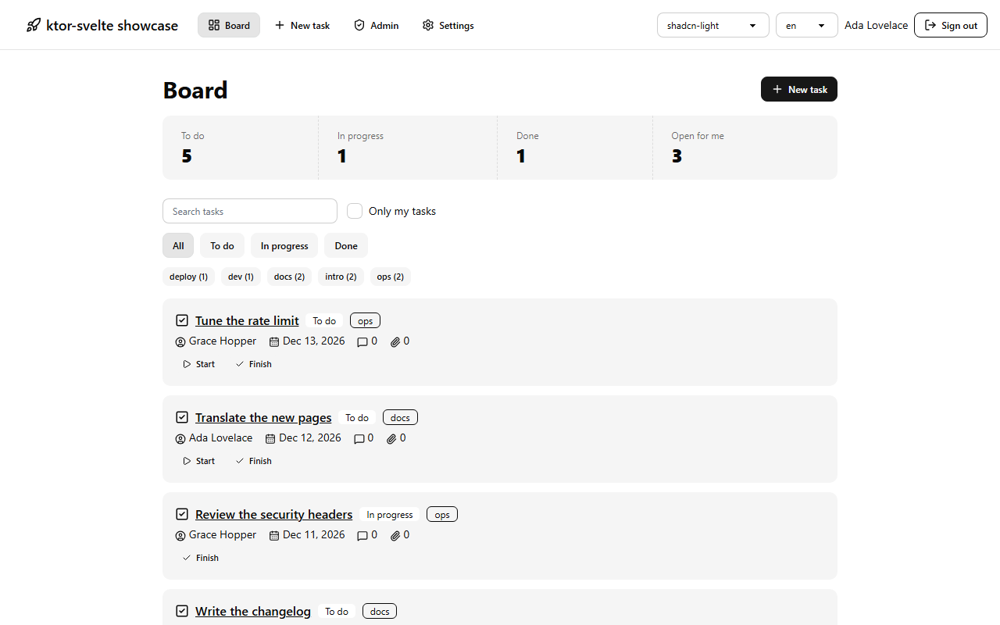
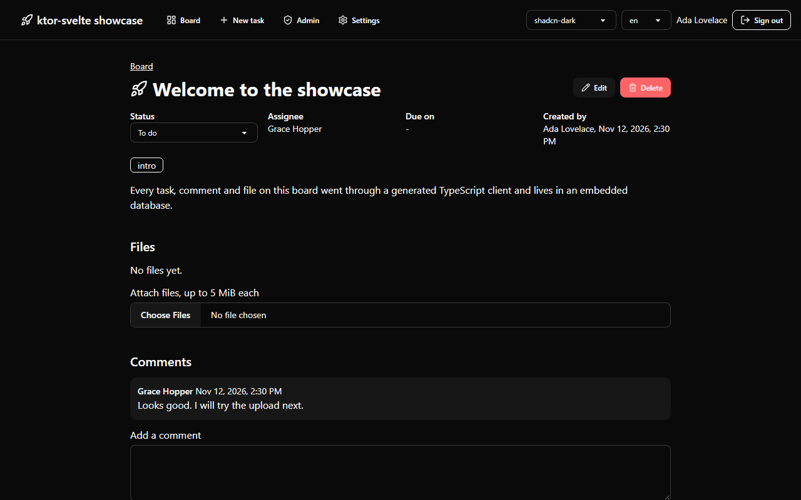
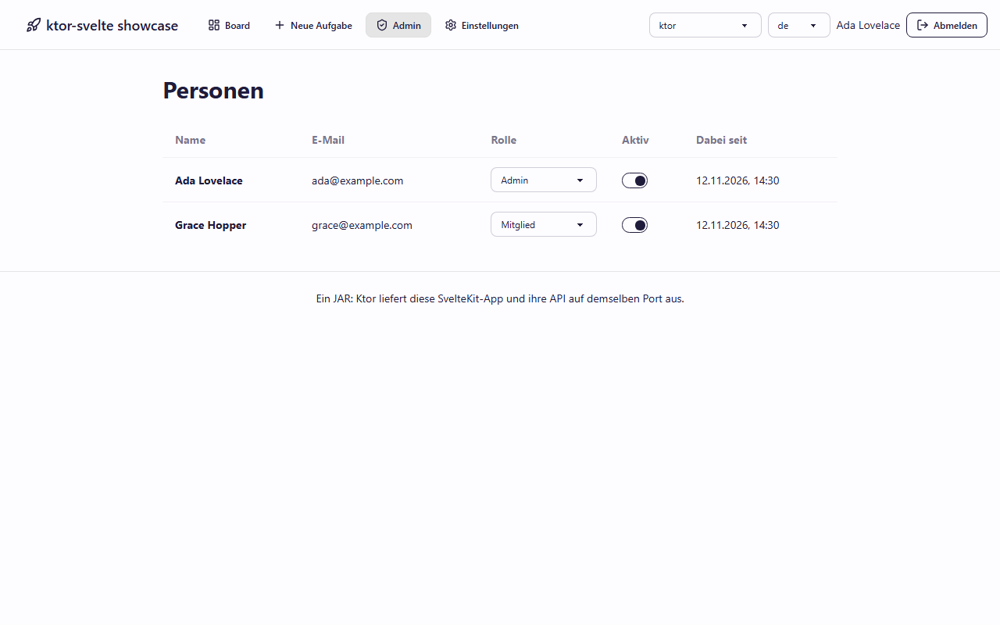

## Taste it

Write a route in Kotlin and save. Call it from Svelte, with the types, the field limits and the errors already there.

::: code-group

```kotlin [Routes.kt]
@Serializable
data class NoteInput(
    @JsonSchema.MinLength(1)
    @JsonSchema.MaxLength(80)
    val title: String,
)

fun Route.noteRoutes(notes: MutableList<Note>) {
    route("/api/notes") {
        get {
            call.respond(notes.toList())
        }
        post {
            val input = call.receive<NoteInput>()
            val note = Note(id = notes.size + 1, title = input.title)
            notes += note
            call.respond(HttpStatusCode.Created, note)
        }
    }
}
```

```svelte [+page.svelte]
<script lang="ts">
    import { api, isValidationError, type Note } from '#api';

    let notes = $state<Note[]>([]);
    let title = $state('');
    let errors = $state<Record<string, string[]>>({});

    $effect(() => {
        api.notes.list().then((list) => (notes = list));
    });

    async function add(event: SubmitEvent) {
        event.preventDefault();
        try {
            await api.notes.create({ title });
            notes = await api.notes.list();
            title = '';
            errors = {};
        } catch (error) {
            if (!isValidationError(error)) throw error;
            errors = error.body.fields;
        }
    }
</script>

<form onsubmit={add}>
    <input bind:value={title} placeholder="Title" />
    {#each errors.title ?? [] as message}
        <p>{message}</p>
    {/each}
    <button type="submit">Add</button>
</form>

<ul>
    {#each notes as note (note.id)}
        <li>{note.title}</li>
    {/each}
</ul>
```

:::

`api.notes.list()` returns `Note[]`, `api.notes.create` only takes a `NoteInput`, and a title that breaks the limits comes back as a field error. Rename `title` in Kotlin, and `svelte-check` points at every line that needs to change. The [tutorial](./guide/tutorial.md) builds this app step by step.

## What you get

- **One app.** In production, one JVM process serves your pages and your API on one port. In development you open the same port and get Vite's hot reload.
- **Your routes win.** A Ktor route beats a frontend page with the same path, whatever order you register them in.
- **Types across the line.** DTOs, enums, sealed classes, IDs, dates, money, constants, error codes and permissions reach TypeScript with their Kotlin names.
- **Batteries in Gradle.** Tailwind, DaisyUI, Lucide, charts, fonts, images, i18n, components and an installable app, each one line in `build.gradle.kts`.
- **Checks that catch drift.** `./gradlew check` fails when the committed client or the generated frontend files are out of date.
- **Tests in Kotlin.** Drive a real browser against the packaged JAR with the [browser test kit](./guide/browser-tests.md).

Every feature, grouped and linked, is on [Everything ktor-svelte does](./features/). What the last major release brought is in [New in 1.0](./releases/1.0.md).

## See it in an app

The [showcase example](./examples.md#showcase) is a team board with sign in, roles, a database, file uploads, search and two languages. These are pictures of its production JAR: one process that serves the pages and the API.



A task in the dark theme, with its files and comments:



The admin area in German and in a custom theme, both set from Gradle:



The pictures come from `./gradlew -p examples/showcase screenshots`, so they show what the current code does.
